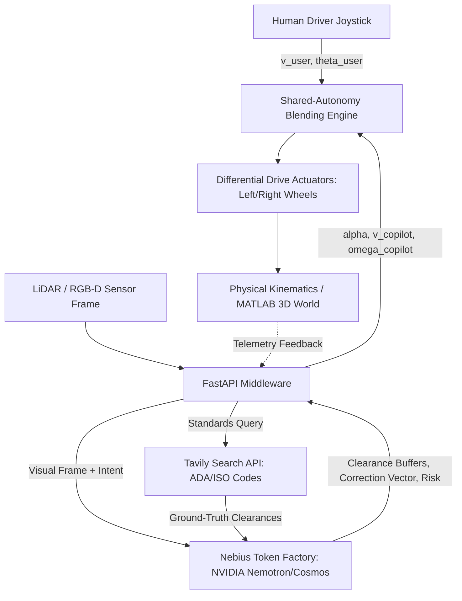

# ♿ WAYLO: YOUR WORLD. YOUR WAY.
> **Physical AI Shared-Autonomy Spatial Copilot for Electric Wheelchairs**  
> *Submitted to the NVIDIA x Nebius Global AI Hackathon — Physical AI Track*  
> Powered by **NVIDIA Nemotron-3-Ultra / Cosmos** on **Nebius AI Cloud** & **Tavily Search API**

[](https://studio.nebius.ai)
[](https://tokenfactory.nebius.com)
[](http://localhost:8000/docs)
[](https://streamlit.io)
[](https://mathworks.com)
[](https://tavily.com)

---

## 🌟 1. Executive Summary & Problem Statement

Over **75 million people worldwide** require a wheelchair for daily mobility. For individuals living with cerebral palsy, ALS, spinal cord injuries, or tremors, navigating narrow doorways (standard 32" / 0.81m clearance) and tight interior corridors is high-stress and dangerous. Minor joystick steering deviations frequently cause scraping, doorframe impacts, and wheel entanglements.

Existing automated solutions either:
1. **Fully take over control**, stripping users of their autonomy and dignity, or
2. **Simple hard brakes**, creating abrupt, jarring stops.

### The WAYLO Solution
**WAYLO** is a **shared-autonomy physical AI copilot** that preserves the user's agency. Rather than replacing the driver, WAYLO operates as an invisible guardian:
- Continuously blends human joystick inputs with real-time spatial vision guidance from **NVIDIA Nemotron-3-Ultra / Cosmos** hosted on **Nebius AI Cloud**.
- Dynamically queries **Tavily Search API** for real-time ADA Title III and ISO 7176 accessibility codes.
- Modulates steering vectors through differential-drive kinematics to guide wheelchairs smoothly through narrow thresholds while reserving **Autonomous Emergency Braking (AEB)** for imminent hazards.

---

## 🏛️ 2. System Architecture

```text
                               +--------------------------------------------+
                               |            USER JOYSTICK INPUT             |
                               |  v_user (linear)  |  theta_user (steering) |
                               +---------------------+----------------------+
                                                     |
                                                     v
+------------------------+             +-----------------------------+
|    TAVILY SEARCH API   |             |   WAYLO FASTAPI MIDDLEWARE  |
| Real-time ADA/ISO 7176 | ----------> |    (backend/main.py :8000)   | <--------+
| Accessibility Codes    |             +--------------+--------------+          |
+------------------------+                            |                         |
                                                      v                         |
                                     +--------------------------------+         |
                                     |        NEBIUS AI CLOUD         |         |
                                     |    (Nebius Token Factory)      |         |
                                     |    - nvidia/nemotron-3-ultra   |         |
                                     |    - nvidia/cosmos-nemotron-34b|         |
                                     +----------------+---------------+         |
                                                      |                         |
                                                      v                         |
                                     +--------------------------------+         |
                                     |   SHARED AUTONOMY ARBITRATION  |         |
                                     |  v_final = (1-α)v_u + α v_ai   |         |
                                     |  ω_final = (1-α)ω_u + α ω_ai   |         |
                                     +----------------+---------------+         |
                                                      |                         |
                                                      v                         |
                       +------------------------------+-------------------------+----+
                       |                                                             |
                       v                                                             v
+-----------------------------------------------+             +-----------------------------------------------+
|          STREAMLIT COCKPIT DASHBOARD          |             |             MATLAB 3D SIMULATION              |
|        (simulation_streamlit/app.py)          |             |       (simulation_matlab/waylo_*.m)           |
| - Top-down LiDAR Perception Grid              |             | - 3D Indoor Room & Wheelchair Mesh            |
| - Unassisted vs WAYLO Comparative Trajectory  |             | - Runge-Kutta 4th Order Kinematic ODEs        |
| - Differential Wheel Speeds (ω_L, ω_R)        |             | - Hardware-in-the-Loop HTTP Telemetry Hook    |
+-----------------------------------------------+             +-----------------------------------------------+
```

### Perception & Control Flow (Mermaid)



---

## 📐 3. Mathematical Foundations

### A. Unicycle & Differential Drive Kinematics
Electric wheelchairs operate on two independent drive wheels ($r = 0.16\text{ m}$) separated by track width wheelbase ($L = 0.60\text{ m}$):

$$\dot{x}(t) = v(t) \cos(\theta(t)), \quad \dot{y}(t) = v(t) \sin(\theta(t)), \quad \dot{\theta}(t) = \omega(t)$$

Wheel angular velocities $\omega_L$ and $\omega_R$ are related to chassis linear velocity $v$ and yaw rate $\omega$ by:

$$v_R(t) = v(t) + \frac{\omega(t) \cdot L}{2}, \quad v_L(t) = v(t) - \frac{\omega(t) \cdot L}{2}$$
$$\omega_{\text{wheel}, R} = \frac{v_R(t)}{r}, \quad \omega_{\text{wheel}, L} = \frac{v_L(t)}{r}$$

### B. Shared-Autonomy Dynamic Arbitration Model
Rather than a binary switch between manual and automated modes, WAYLO computes a continuous arbitration weight $\alpha(t) \in [0.0, 1.0]$:

$$\mathbf{v}_{\text{final}}(t) = (1 - \alpha(t)) \mathbf{v}_{\text{user}}(t) + \alpha(t) \mathbf{v}_{\text{copilot}}(t)$$
$$\theta_{\text{final}}(t) = \theta_{\text{user}}(t) + \alpha(t) \cdot \Delta \theta_{\text{copilot}}(t)$$

Where $\alpha(t)$ is dynamically scaled by perceived hazard risk $R \in [0, 100]$ and clearance buffer margin deficit:

$$\alpha(t) = \mathrm{clip}\left(0.55 \left(\frac{R}{100}\right) + 0.45 \max\left(0, \frac{d_{\text{safe}} - \min(d_L, d_R)}{d_{\text{safe}}}\right), 0.0, 1.0\right)$$

- When clearances are wide ($d > 0.5\text{ m}$) and risk is nominal, $\alpha \to 0.0$ (100% human authority).
- As the wheelchair approaches a narrow 1.4m doorway with lateral drift, $\alpha$ scales smoothly up to $0.75$, applying gentle centering vectors.
- If an obstacle appears within critical stopping distance $d_{\text{stop}} = \frac{v^2}{2 a_{\max}} + d_{\text{margin}}$, $\alpha = 1.0$ and Autonomous Emergency Braking halts the vehicle.

---

## 📁 4. Repository Structure

```text
WAYLO/
├── .env.example                     # Environment credentials template (Nebius, Tavily, FastAPI)
├── .gitignore                       # Clean Git tracking configuration
├── README.md                        # Complete project documentation & guide
├── requirements.txt                 # Python dependencies
├── backend/
│   ├── __init__.py                  # Backend module interface
│   ├── nebius_client.py             # NVIDIA Nemotron/Cosmos client on Nebius AI + offline engine
│   ├── tavily_search.py             # Real-time ADA/ISO building standards search client
│   └── main.py                      # FastAPI REST server & kinematics blending API
├── simulation_matlab/
│   ├── waylo_3d_environment.m       # 3D Indoor Room, Wheelchair geometry & trajectory animation
│   └── waylo_kinematics_sim.m       # ODE differential drive simulation & comparative benchmark
└── simulation_streamlit/
    └── app.py                       # Interactive Cockpit Dashboard & LiDAR perception visualizer
```

---

## ⚡ 5. Quick Start Guide

### Step 1: Clone & Install Dependencies
Ensure Python 3.10+ is available:

```bash
git clone https://github.com/your-org/WAYLO.git
cd WAYLO
pip install -r requirements.txt
```

### Step 2: Configure Environment Variables
Copy `.env.example` to `.env`:

```bash
cp .env.example .env
```

Edit `.env` with your Nebius AI Cloud and Tavily credentials:
```ini
NEBIUS_API_KEY=your_nebius_api_key_here
NEBIUS_BASE_URL=https://api.studio.nebius.com/v1
NEBIUS_MODEL=nvidia/nemotron-3-ultra
TAVILY_API_KEY=your_tavily_api_key_here
WAYLO_HOST=0.0.0.0
WAYLO_PORT=8000
```
> **Note:** If API keys are left unset, WAYLO automatically engages the **Deterministic Physical Simulation Engine**, allowing full testing offline!

### Step 3: Launch the FastAPI Middleware
Start the backend REST API:

```bash
python -m backend.main
```
*API will run on `http://localhost:8000` with interactive Swagger docs at `http://localhost:8000/docs`.*

### Step 4: Launch the Streamlit Cockpit Visualizer
In a second terminal:

```bash
streamlit run simulation_streamlit/app.py
```
Open `http://localhost:8501` to interact with:
- Top-down 2D LiDAR perception visualizer
- Joystick steering sliders and speed overrides
- Real-time telemetry dials (Clearances, $\alpha$ authority, Hazard risk, Wheel RPMs)
- Live Tavily accessibility standards search

### Step 5: Run the MATLAB Physical Simulations
Open MATLAB and navigate to `simulation_matlab/`:
1. **3D Environment & Animation:**
   ```matlab
   waylo_3d_environment
   ```
   Renders a 3D indoor room, doorway lintel, 3D electric wheelchair with caster wheels and LiDAR cone, and animates trajectory execution.
2. **Kinematic Benchmark & Numerical ODE Integration:**
   ```matlab
   waylo_kinematics_sim
   ```
   Integrates Runge-Kutta 4th-order equations comparing an unassisted driver (collision course) vs WAYLO copilot (zero-impact centered passage).

---

## 📡 6. REST API Reference

| Method | Endpoint | Description |
|:---|:---|:---|
| `GET` | `/` | System overview, active Nebius model, and route map |
| `GET` | `/health` | Health status and Nebius / Tavily connectivity |
| `POST` | `/api/spatial/analyze` | Perceptual inference: returns corrections, clearances, hazard score |
| `POST` | `/api/kinematics/blend` | Differential-drive kinematic blending & wheel angular velocities |
| `POST` | `/api/accessibility/search` | Live ADA/ISO accessibility standards search via Tavily |
| `GET` | `/api/scenarios` | Predefined indoor testing scenarios & geometry |
| `POST` | `/api/matlab/telemetry` | Dedicated high-frequency bridge for MATLAB / Simulink |

### Sample Perception Request (`curl`):
```bash
curl -X POST "http://localhost:8000/api/spatial/analyze" \
  -H "Content-Type: application/json" \
  -d '{
    "frame_metadata": "frame_doorway_001",
    "user_intent": "Align with Doorway",
    "steering_angle_deg": 14.0,
    "velocity_mps": 0.85
  }'
```

### Sample Response:
```json
{
  "status": "SUCCESS",
  "source": "nebius_cloud",
  "model": "nvidia/nemotron-3-ultra",
  "user_intent": "Align with Doorway",
  "steering_correction_deg": -14.0,
  "arbitration_alpha": 0.68,
  "speed_buffer_override": "NOMINAL",
  "recommended_velocity": "0.7 m/s",
  "clearance_left": 0.31,
  "clearance_right": 0.49,
  "hazard_risk_score": 28,
  "emergency_stop": false,
  "time_to_collision_sec": 3.82,
  "spatial_summary": "Doorway detected at Y=4.5m (1.4m opening). Compensating user steering by -14.0° to center trajectory through gateway."
}
```

---

## 🧪 7. Benchmark Testing Scenarios

1. **Align with Doorway (1.4m opening at Y = 4.5m)**:
   - *Challenge:* Human applies involuntary $+14^\circ$ steering deviation towards doorpost.
   - *Unassisted:* Collides with right doorpost ($X = +0.7\text{ m}$).
   - *WAYLO:* Detects clearance asymmetry, engages $\alpha = 0.68$, centers wheelchair ($X = 0.0\text{ m}$) with safe $\ge 0.35\text{ m}$ margins on both sides.
2. **Navigate Tight Corridor (1.2m bounded walls)**:
   - *Challenge:* Oscillating steering inputs inside a narrow hallway.
   - *WAYLO:* Limits velocity to $0.6\text{ m/s}$, applies proportional damping to prevent wall scraping.
3. **Dock at Table / Workstation**:
   - *Challenge:* Approaching desk for transfer or dining without knee impact.
   - *WAYLO:* Regulates terminal velocity to $0.3\text{ m/s}$ with progressive decel curve.
4. **Emergency Stop Test (Dynamic Obstacle at 0.45m)**:
   - *Challenge:* Sudden pedestrian or obstacle steps into vehicle path.
   - *WAYLO:* Autonomous Emergency Braking (AEB) engages in $< 50\text{ ms}$, clamping velocity to $0.0\text{ m/s}$.

---

## 🏆 8. Hackathon Track Alignment

- **Physical AI Track**: Embeds frontier AI directly into closed-loop physical kinematics (differential drive equations, Runge-Kutta integration, real-time actuator wheel speeds).
- **NVIDIA Nemotron & Cosmos**: Utilizes Nemotron-3-Ultra and Cosmos reasoning models to synthesize spatial geometry into continuous trajectory arbitration.
- **Nebius AI Cloud (Token Factory)**: Hosted on high-performance Nebius infrastructure delivering low-latency inference for robotic control loops.
- **Tavily Search API**: Connects the perception engine to real-time ground-truth architectural accessibility codes (ADA Title III, Section 404 & ISO 7176).

---

## 📄 License
This project is licensed under the MIT License — see the [LICENSE](LICENSE) file for details.
