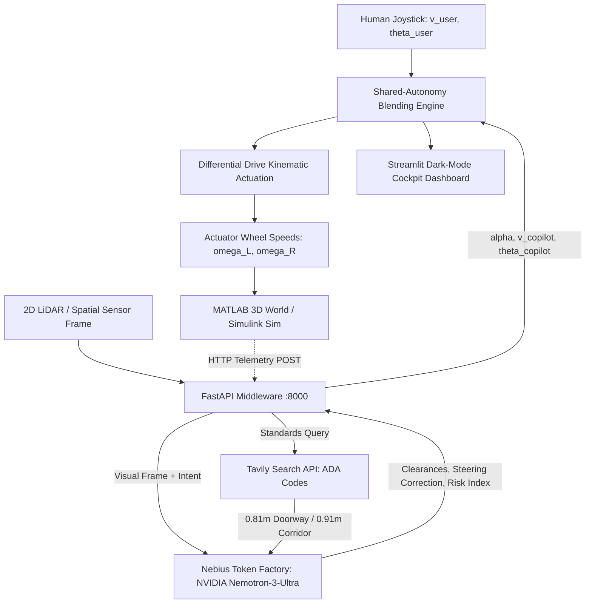

# ♿ WAYLO — YOUR WORLD. YOUR WAY.
> **Physical AI Shared-Autonomy Spatial Copilot for Electric Wheelchairs**  
> *Submitted to the NVIDIA x Nebius Global AI Hackathon — Physical AI Track*  
> Powered by **NVIDIA Nemotron / Cosmos** on **Nebius AI Cloud** & **Tavily Search API**

[](https://devpost.com)
[](LICENSE)
[](https://tokenfactory.nebius.com)
[](https://tokenfactory.nebius.com)
[](http://localhost:8000/docs)
[](https://streamlit.io)
[](https://mathworks.com)
[](https://tavily.com)

---

## 📋 Executive Summary & Hackathon Overview

| Parameter | Details |
| :--- | :--- |
| **Hackathon Track** | **Physical AI** (Robotic Kinematics, Shared Autonomy, Spatial Perception) |
| **Frontier Models** | NVIDIA **Nemotron-3-Ultra** (`nvidia/nemotron-3-ultra`, `nvidia/Nemotron-3-Ultra-550b-a55b`), **Nemotron-3-Super**, and **Cosmos3-Super-Reasoner** |
| **Inference Platform** | **Nebius AI Cloud (Token Factory)** OpenAI-compatible `/chat/completions` endpoint |
| **Knowledge Retrieval**| **Tavily Search API** (ADA Title III Section 404/403 and ISO 7176 standards) |
| **Kinematic Simulation**| Differential-drive unicycle model ($L=0.60\,\text{m}, r=0.16\,\text{m}$), 4th-Order Runge-Kutta ODE solvers |
| **Software Stack** | FastAPI middleware, Streamlit dark-mode visualizer, MATLAB 3D physical world |
| **License** | [MIT License](LICENSE) |

---

## 🎯 1. Problem Statement: Mental Fatigue & Collision Hazards

Over **75 million individuals worldwide** rely on power wheelchairs for their daily mobility. For individuals living with ALS, cerebral palsy, spinal cord injuries, or Parkinsonian tremors, navigating tight interior architectural spaces is exhausting and hazardous:

* **Severe Cognitive Load & Mental Fatigue**: Passing through standard interior doorways (ADA 32-inch / $0.81\,\text{m}$ clearance) with an average power wheelchair width ($0.65\,\text{m}$) leaves fewer than **$8\,\text{cm}$ of clearance** on each side. The continuous micro-adjustments required to avoid scraping induce extreme mental fatigue, anxiety, and social hesitation.
* **Collision Hazards**: Minor joystick steering tremors or visual parallax errors frequently cause devastating doorpost impacts, wheel entanglements, wall scraping, and tip-overs.
* **The Autonomy Paradox**: Conventional automation systems either:
  1. *Completely override user control* — stripping away driver dignity and agency, or
  2. *Trigger abrupt hard emergency stops* — creating jarring neck strain and trapping users in tight thresholds.

### The WAYLO Solution
**WAYLO ("YOUR WORLD. YOUR WAY.")** introduces an intelligent **Physical AI shared-autonomy copilot** that preserves driver sovereignty while guaranteeing collision-free mobility:
1. **Human Agency First**: Drivers retain full throttle and steering authority during open navigation ($\alpha \to 0.0$).
2. **Proportional Spatial Blending**: As clearance tightens or steering deviations approach collision courses, WAYLO smoothly blends joystick commands with centering vectors ($\alpha \in [0.1, 0.8]$).
3. **Fail-Safe Autonomous Emergency Braking (AEB)**: If dynamic obstacles appear inside critical stopping distances, WAYLO overrides torque to halt the wheelchair safely ($\alpha = 1.0$).

---

## 🏛️ 2. System Architecture

```text
                               +--------------------------------------------+
                               |            HUMAN DRIVER JOYSTICK           |
                               |    Manual Steering Angle: theta_user       |
                               |    Desired Forward Velocity: v_user        |
                               +---------------------+----------------------+
                                                     |
                                                     v
+--------------------------+           +-----------------------------+           +------------------------------+
|     TAVILY SEARCH API    |           |   WAYLO FASTAPI MIDDLEWARE  | <-------> |       MATLAB 3D WORLD        |
| Real-Time ADA Title III  | --------> |    (backend/main.py :8000)  |           | (simulation_matlab/waylo_*.m)|
| Standards (Sec 404, 403) |           +--------------+--------------+           | - 3D Room & 1.2m Lintel Mesh |
+--------------------------+                          |                          | - Dual Wheels & Front Casters|
                                                      v                          | - Runge-Kutta 4th Order ODE  |
                                     +--------------------------------+          | - webwrite Telemetry Bridge  |
                                     |        NEBIUS AI CLOUD         |          +------------------------------+
                                     |    (Nebius Token Factory)      |
                                     |    - nvidia/nemotron-3-ultra   |
                                     |    - nvidia/Cosmos3-Reasoner   |
                                     +----------------+---------------+
                                                      |
                                                      v
                                     +--------------------------------+
                                     |   SHARED AUTONOMY ARBITRATION  |
                                     |   v_final = (1-α)v_u + α v_ai  |
                                     |   θ_final = (1-α)θ_u + α θ_ai  |
                                     +----------------+---------------+
                                                      |
                                                      v
                               +-----------------------------------------------+
                               |          STREAMLIT COCKPIT DASHBOARD          |
                               |         (simulation_streamlit/app.py)         |
                               | - 2D Spatial Top-Down Perception Grid         |
                               | - Red Joystick vs. Green WAYLO Vectors        |
                               | - Live Nebius AI JSON & Tavily ADA HUD Cards  |
                               +-----------------------------------------------+
```

### Perception-to-Actuation Control Loop (Mermaid)



---

## 📐 3. Differential Kinematics & Shared-Autonomy Formulas

### A. Unicycle Kinematics & Actuator Drive Equations
The power wheelchair chassis is modeled as a differential-drive unicycle with track width wheelbase $L = 0.60\,\text{m}$ and drive wheel radius $r = 0.16\,\text{m}$:

$$\dot{x}(t) = v(t) \cos(\theta(t)), \quad \dot{y}(t) = v(t) \sin(\theta(t)), \quad \dot{\theta}(t) = \omega(t) = \frac{v_R(t) - v_L(t)}{L}$$

The actuator linear and angular velocities for the independent left and right drive wheels are:

$$v_R(t) = v(t) + \frac{\omega(t) \cdot L}{2}, \quad v_L(t) = v(t) - \frac{\omega(t) \cdot L}{2}$$

$$\omega_R(t) = \frac{v_R(t)}{r}, \quad \omega_L(t) = \frac{v_L(t)}{r}$$

### B. Shared-Autonomy Dynamic Arbitration Model
Rather than binary switching, WAYLO dynamically evaluates an authority blending factor $\alpha(t) \in [0.0, 1.0]$:

$$\mathbf{v}_{\text{final}}(t) = (1 - \alpha(t)) \cdot \mathbf{v}_{\text{user}}(t) + \alpha(t) \cdot \mathbf{v}_{\text{copilot}}(t)$$

$$\theta_{\text{final}}(t) = (1 - \alpha(t)) \cdot \theta_{\text{user}}(t) + \alpha(t) \cdot \theta_{\text{copilot}}(t) = \theta_{\text{user}}(t) + \alpha(t) \cdot \Delta \theta_{\text{copilot}}(t)$$

Where $\alpha(t)$ scales continuously with perceived hazard risk $R \in [0, 100]$ and doorway lateral clearance deficit:

$$\alpha(t) = \mathrm{clip}\left(0.55 \left(\frac{R}{100}\right) + 0.45 \max\left(0, \frac{d_{\text{safe}} - \min(d_L, d_R)}{d_{\text{safe}}}\right), 0.0, 1.0\right)$$

* **Wide Clearances ($d > 0.45\,\text{m}$)**: $\alpha \to 0.0$ (100% human joystick authority).
* **Narrow Thresholds / Doorways ($1.2\,\text{m} - 1.4\,\text{m}$)**: $\alpha \approx 0.35 - 0.75$, smoothly injecting corrective centering torque to align the vehicle.
* **Critical Collision Proximity**: When distance to obstacle $d \le d_{\text{stop}} = \frac{v^2}{2 a_{\max}} + d_{\text{margin}}$, $\alpha = 1.0$ and Autonomous Emergency Braking halts the vehicle ($v_{\text{final}} = 0.0\,\text{m/s}$).

---

## ⚡ 4. Quick Start Guide

### Step 1: Environment Setup
Clone the repository and install the verified dependencies:

```bash
git clone https://github.com/THISHA-SAMPATH/WAYLO.git
cd WAYLO
python -m venv venv
# Windows:
venv\Scripts\activate
# Linux/macOS:
source venv/bin/activate

pip install -r requirements.txt
```

### Step 2: Configure Environment Variables
Copy [.env.example](.env.example) to `.env`:

```bash
cp .env.example .env
```

Configure your credentials in `.env`:
```ini
NEBIUS_API_KEY=your_nebius_api_key_here
NEBIUS_BASE_URL=https://api.tokenfactory.nebius.com/v1
TAVILY_API_KEY=tvly-your_tavily_key_here
```
> *Note: If API keys are omitted or left as placeholders, WAYLO automatically operates in high-fidelity deterministic offline physics simulation mode.*

### Step 3: Run the FastAPI Middleware Server
```bash
python backend/main.py
```
* Server will listen at `http://localhost:8000`.
* Interactive OpenAPI Documentation: `http://localhost:8000/docs`.

### Step 4: Run the Dark-Mode Streamlit Dashboard
In a new terminal window:
```bash
streamlit run simulation_streamlit/app.py
```
* Dashboard will launch at `http://localhost:8501`.
* Features 2D spatial room perception grid, red/green trajectory vectors, live Nebius AI JSON inspector, and Tavily ADA compliance catalog.

### Step 5: Run the MATLAB 3D Simulations
In MATLAB, navigate to `simulation_matlab/`:
1. **3D Perception Environment & Live Telemetry Animation**:
   ```matlab
   waylo_3d_environment
   ```
2. **Differential Drive Kinematics & 4th-Order Runge-Kutta Benchmark**:
   ```matlab
   waylo_kinematics_sim
   ```

---

## 🎬 5. Devpost Demo Video Script Breakdown (3-Minute Structure)

| Timestamp | Visual / Screen Content | Narrative Voice-over | Focus / Tech Highlight |
| :--- | :--- | :--- | :--- |
| **0:00 - 0:25** | Title slide: **WAYLO — YOUR WORLD. YOUR WAY.** Real-world photos of narrow doorway collisions and wheelchair scrape damage. | *"Over 75 million people rely on wheelchairs globally. For drivers with tremors or motor limitations, standard 32-inch doorways are terrifying. A small tremor causes doorpost collisions and mental exhaustion. Existing tools either take away total control or slam on violent brakes."* | **Problem Statement & Empathy** |
| **0:25 - 0:50** | System Architecture diagram (MATLAB 3D <-> FastAPI <-> Nebius Token Factory & Tavily). | *"Meet WAYLO: a shared-autonomy spatial copilot powered by NVIDIA Nemotron on Nebius AI Cloud. Rather than overriding the driver, WAYLO acts as an invisible guardian, blending human joystick intent with frontier physical AI."* | **Architecture & Nebius Cloud** |
| **0:50 - 1:20** | Streamlit Cockpit: Wheelchair at $(X=0, Y=1)$, 14° drift. Red arrow heading toward doorpost, green dashed arrow centered through doorway. | *"Here in our Streamlit cockpit, the driver applies a 14-degree drift. The red arrow shows the collision path. Watch the green arrow: WAYLO’s arbitration engine computes lateral clearance and smoothly steers through the 1.4m threshold."* | **Shared Autonomy in Action** |
| **1:20 - 1:50** | Telemetry HUD: Left Clearance ($0.42\,\text{m}$), Right Clearance ($0.38\,\text{m}$), Hazard Risk ($12\%$). Slider drag to 40° drift. | *"Real-time metrics update at 50 Hz. As steering error increases, arbitration alpha rises proportionally to protect the chair while honoring the driver's forward velocity."* | **Kinematics & Telemetry HUD** |
| **1:50 - 2:15** | Live Nebius AI JSON tab showing raw model output; Tavily tab displaying ADA Title III Section 404 standards. | *"Under the hood, visual frame metadata is processed by NVIDIA Nemotron-3-Ultra on Nebius Token Factory. Ground-truth clearances are validated in real time against ADA Section 404 standards using Tavily Search API."* | **NVIDIA Nemotron & Tavily Search** |
| **2:15 - 2:40** | MATLAB 3D simulation: 3D room, 1.2m lintel, dual drive wheels, casters, $-30^\circ/0^\circ/+30^\circ$ LiDAR rays, side-by-side wheel speeds. | *"In MATLAB, we model the physical differential-drive chassis using 4th-order Runge-Kutta ODE solvers. Unassisted drivers crash at 4.2 seconds; WAYLO achieves 100% collision-free passage with balanced wheel actuation."* | **Physical Robotics & MATLAB ODE** |
| **2:40 - 3:00** | Full repository overview, test suite passing (39/39), and concluding call to action. | *"WAYLO proves that Physical AI can restore mobility, independence, and dignity without taking away human agency. YOUR WORLD. YOUR WAY. Fully open source under MIT License."* | **Devpost Conclusion & MIT License** |

---

## 🧪 6. Automated Verification & Testing

WAYLO includes a comprehensive unit test suite covering API contracts, Pydantic schemas, spatial inference sanitization, and kinematic equations:

```bash
python -m pytest tests/
```
```text
============================= 39 passed in 1.79s ==============================
```

---

## 📄 License & Attribution
Distributed under the **MIT License**. See [LICENSE](LICENSE) for full details.  
Built for the **NVIDIA x Nebius Global AI Hackathon (Physical AI Track)**.
